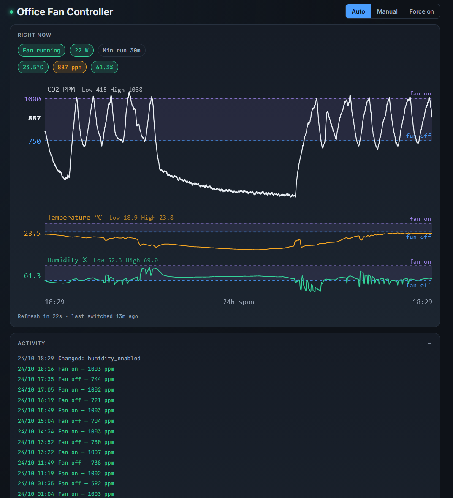

# Office Fan Controller

Controls a ventilation fan using a UniFi Protect UP-AirQuality sensor and a
Tasmota smart plug. CO2, temperature and humidity can trigger the fan
independently, with hysteresis and a minimum run time. Optional power monitoring
stops the fan and latches a fault when its draw remains outside the expected band.



Supported targets are x86-64 Debian/Ubuntu and Raspberry Pi 3B+ with a 64-bit
Debian-based image. Python 3.15 or newer is required. Flask listens only on
`127.0.0.1:8096`; use an SSH tunnel or nginx on the same host for access.

## Get started

Docker/Unraid users: see [container installation and image channels](Docs/docker.md).
The native installer below remains supported. Never run both against one plug.

Run as the ordinary account that will operate the service, not as root:

```sh
git clone https://github.com/holloway25/Fan-Controller.git
cd Fan-Controller
./install.sh --unit
sudo systemctl start office-fan-controller
```

The installer creates a private `config.json` from the example, installs pinned
dependencies, and generates and installs the systemd unit. It does not start
or restart the service. The example starts in **Manual**, with power monitoring
off. Existing settings are preserved when the installer is re-run.

Before configuring nginx, open an SSH tunnel from your computer:

```sh
ssh -L 8096:127.0.0.1:8096 <user>@<server>
```

Open `http://127.0.0.1:8096`, configure Protect and the plug, and test both before
selecting Auto. Follow the [installation guide](Docs/installation.md) for setup,
HTTPS and manual installation.

## Operating modes and safety

| Mode | Behaviour |
|---|---|
| Auto | Enabled sensor rules control the fan |
| Manual | Switch off once, then leave the plug under external control |
| Force on | Keep the fan on, including when a safety fault is active |

Manual is **not** a continuous force-off mode. Force on overrides draw faults:
use it only when deliberately testing hardware that is safe to run. Clear a
fault only after checking the fan and its measured draw.

Missing readings do not release an existing sensor latch. A configurable
stale-reading fail-safe can ventilate in Auto; a latched draw fault blocks it.
See [control logic](Docs/control-logic.md) for the complete behaviour.

## Updates and routine operation

```sh
systemctl status office-fan-controller
journalctl -u office-fan-controller -f
```

For a reviewed code update with unchanged dependencies and systemd unit:

```sh
git pull --ff-only
./restart.sh
```

Documentation-only changes do not need a restart. Dependency and unit changes
need additional steps: see [operations and upgrades](Docs/operations.md).
`restart.sh` preserves transient control state; a systemd restart does not.

Keep each installation's configuration local. Never copy production settings
onto a development instance that can reach the same plug, or run two active
controllers against one fan. Live settings, credentials and runtime files must
not be committed.

Use mocked devices, an isolated test plug or blocked access to production for
development. Manual and disabled power monitoring do not provide isolation;
Manual still commands a one-time stop.

## Documentation

- [Installation and first setup](Docs/installation.md)
- [Operations and upgrades](Docs/operations.md)
- [Configuration and alerts](Docs/configuration.md)
- [Control logic and safety](Docs/control-logic.md)
- [Dashboard](Docs/dashboard.md)
- [Troubleshooting](Docs/troubleshooting.md)
- [HTTP API](Docs/api.md)
- [Architecture and persistence](Docs/architecture.md)
- [Development checks](Docs/testing.md)
- [Raspberry Pi and ARM](Docs/arm.md)

Protect air-quality data comes from a private bootstrap endpoint that may change
with firmware. Tests do not replace checks of the real sensor, plug and fan.

## License

Copyright (C) 2026 Fan-Controller contributors.

Fan-Controller is free software: you can redistribute it and/or modify it
under the terms of the GNU General Public License as published by the Free
Software Foundation, either version 3 of the License, or (at your option)
any later version (`GPL-3.0-or-later`).

Fan-Controller is distributed in the hope that it will be useful, but
WITHOUT ANY WARRANTY; without even the implied warranty of MERCHANTABILITY
or FITNESS FOR A PARTICULAR PURPOSE. See [LICENSE](LICENSE) for the full
terms. Third-party dependencies retain their own licences.
